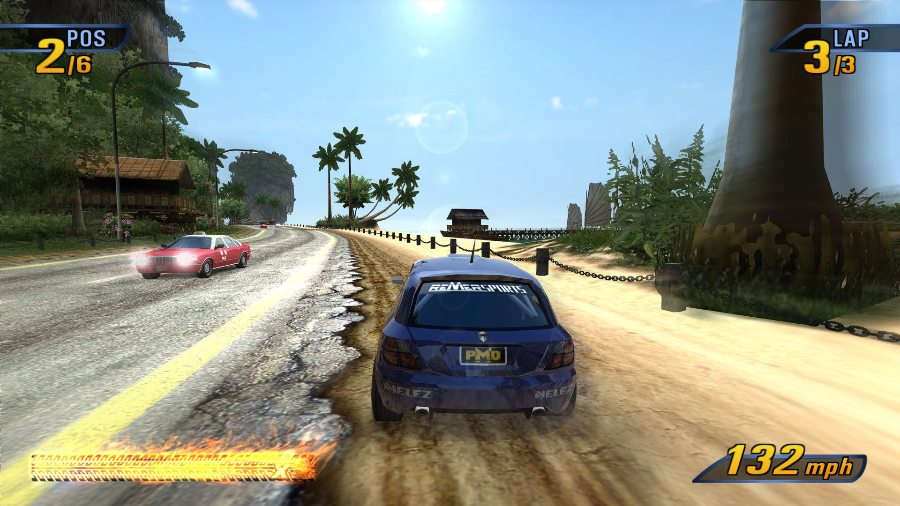
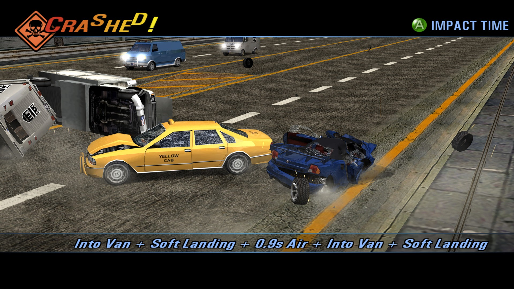
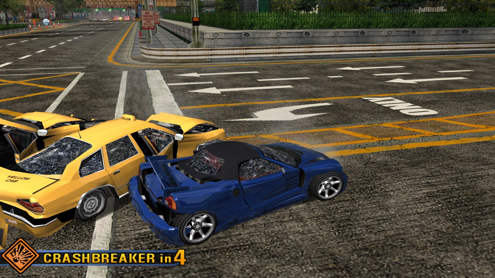
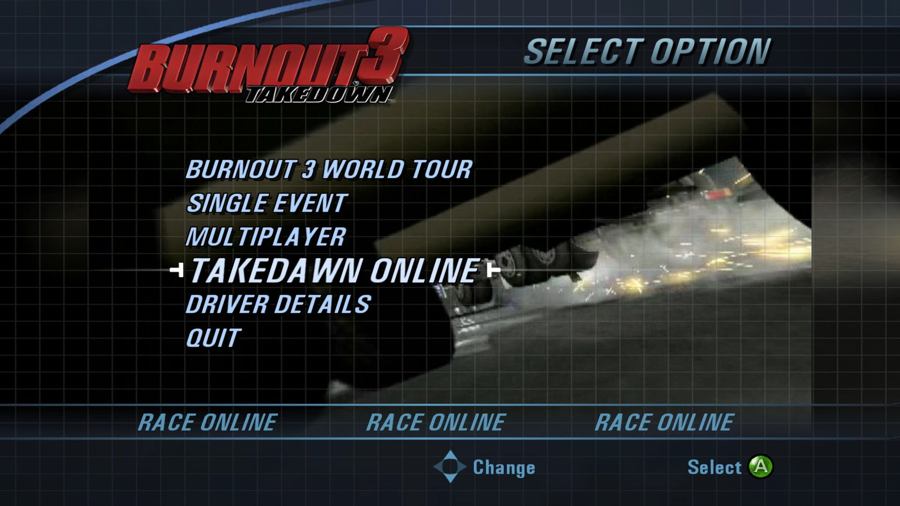
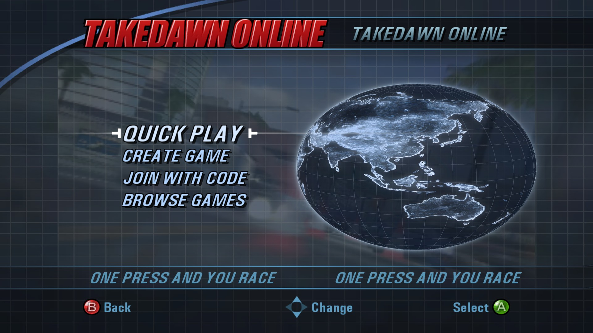
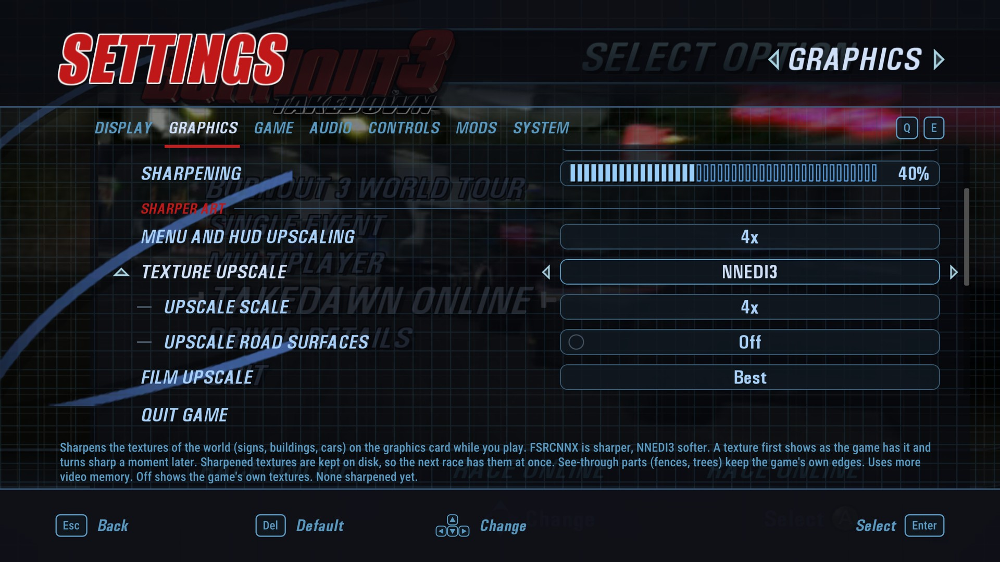
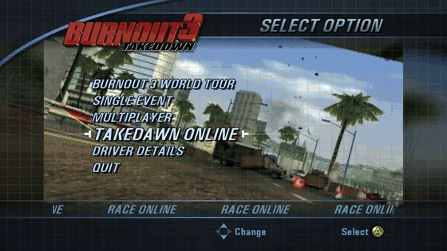
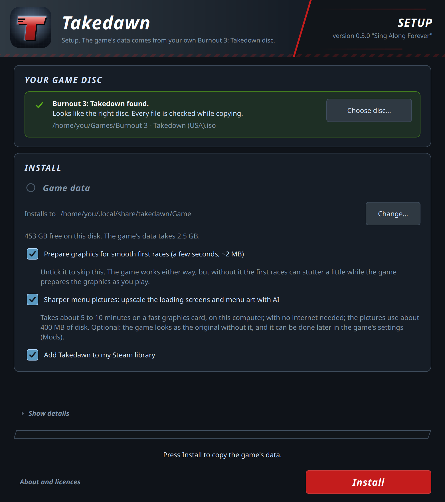

<p align="center">
  
</p>

<h1 align="center">Takedawn</h1>

<p align="center">
  An unofficial static recompilation of the original Xbox version of <i>Burnout 3: Takedown</i>:<br>
  a native program for Mac, Windows, Linux, the Steam Deck and Android handhelds.<br>
  You bring the game data from your own disc.
</p>

<p align="center">
  <a href="#download"><b>Download</b></a>
  &nbsp;·&nbsp;
  <a href="#quick-start">Quick start</a>
  &nbsp;·&nbsp;
  <a href="#faq-and-troubleshooting">FAQ</a>
  &nbsp;·&nbsp;
  <a href="#reporting-a-bug">Report a bug</a>
  &nbsp;·&nbsp;
  <a href="CHANGELOG.md">What's new in 0.3.1</a>
</p>

> [!IMPORTANT]
> Takedawn is an unofficial, non-commercial fan project. It is not affiliated
> with, endorsed by or sponsored by Electronic Arts, Criterion Games or
> Microsoft. All trademarks belong to their owners.
>
> No game data is included or distributed: no disc images, no textures,
> models, sound, music or films, and no shader cache made from them. To play
> you need your own, legally obtained disc of one of the three supported
> retail releases for the original Xbox: North America (NTSC-U) or one of the
> two European (PAL) discs. Takedawn checks a copy of it and takes the game
> data from there. Please do not ask for game files or disc images,
> and do not share them. See the full [legal notice](#legal-notice).

TL;DR

- This is a port, not a remaster. It runs the original 2004 game with its
  own cars, tracks, textures and physics. The picture and sound extras are options on top.
- Takedawn runs the original Xbox *Burnout 3: Takedown* as a native program.
- Compared with the console: up to 4x resolution, widescreen and ultrawide,
  60 fps crash cameras, and music and 60 fps in split screen. Custom
  soundtracks play from a folder of your own MP3 or FLAC files.
  [Highlights](#highlights) has the rest.
- New in 0.3.0: online play. Pick TAKEDAWN ONLINE in the main menu for
  QUICK PLAY, a game with a code for your friends, or the list of games. See
  [docs/online.md](docs/online.md).

> [!IMPORTANT]
> Open ports give online play the lowest ping. The player who creates a game
> should have UDP 31000 and 36000 open. Takedawn asks the router to open them
> (UPnP). If UPnP is off on your router, forward both ports to your computer
> by hand. Since 0.3.1, players who can't connect to each other directly play
> through the game server's relay instead of being removed from the game. The
> relay adds a little ping.

- The European discs work too: all three discs (North America, Europe, and
  Europe and Australia) in one download, with the game in your disc's
  languages.
- [Download](#download) it for your device and start it. For
  [full speed](#for-full-speed-60-fps) it needs about a Steam Deck's power.
- On Windows a few antivirus tools flag the unsigned installer. It is a false
  positive; see [Antivirus warnings](docs/antivirus.md).
- Point it at a disc image of your own Burnout 3. It installs the game data,
  then you play.
- To update, install the new version over the old one. Saves and settings stay.
- Mods go in a mods folder and switch on and off in the game's own MODS
  page. [CHANGELOG.md](CHANGELOG.md) has everything that is new in 0.3.1.
- Settings: Back and Start, F1, or TAKEDAWN SETTINGS in the game's menu.
- Bugs: first check the [known issues](#known-issues). Then switch on
  System > Diagnostic logging, restart the game and make the
  problem happen again. Then System > Create bug report, and attach the zip
  to the [issue form][issues].

<p align="center">
  
</p>

<table>
  <tr>
    <td width="50%"><br><sub>Road Rage with soft-body damage.</sub></td>
    <td width="50%"><br><sub>Crash mode, dents that stay.</sub></td>
  </tr>
  <tr>
    <td width="50%"><br><sub>The main menu with TAKEDAWN ONLINE and QUIT.</sub></td>
    <td width="50%"><br><sub>The online page.</sub></td>
  </tr>
  <tr>
    <td width="50%"><br><sub>A winter city in Europe.</sub></td>
    <td width="50%"><br><sub>Road Rage at the Far East harbour.</sub></td>
  </tr>
  <tr>
    <td width="50%"><br><sub>Settings, Graphics page.</sub></td>
    <td width="50%"><br><sub>Pause menu with a PlayStation pad.</sub></td>
  </tr>
</table>

<p align="center">
  
  <br>
  <sub>The film behind the menus in its 4:3 shape, with blurred sides.</sub>
</p>

<p align="center">
  
  <br>
  <sub>21:9 ultrawide.</sub>
</p>

<p align="center">
  
  <br>
  <sub>Widescreen HUD fix off on top, on below.</sub>
</p>

<p align="center">
  
  <br>
  <sub>Setup window on first start, disc image accepted.</sub>
</p>

<sub>Unedited screenshots, apart from the side-by-side crops. The game content in them belongs to its owners.</sub>

Contents: [What it is](#what-is-takedawn) · [Highlights](#highlights) ·
[Download](#download) · [Quick start](#quick-start) ·
[How to update](#how-to-update) · [Setup by platform](#setup-by-platform) ·
[Controls](#controls) · [Settings](#settings) · [Performance](#performance) ·
[Tips](#tips-for-smooth-play) · [FAQ](#faq-and-troubleshooting) ·
[Known issues](#known-issues) · [What's next](#whats-next) ·
[For developers](#for-developers) · [Credits](#credits) · [How this was made](#how-this-was-made) ·
[Greetings](#greetings) · [Licence](#licence) · [Legal notice](#legal-notice)

## What is Takedawn?

Takedawn runs the original Xbox release of *Burnout 3: Takedown* as an
ordinary program on your device. The game's own code was translated ahead of
time into a native program for x86-64 and arm64. The menus, the races and
Crash mode all run that translated code (see [how it works](#how-it-works)).
It works with three versions of the game: the North American disc and the two
European ones.

The download is only the program. The game data (cars, tracks, sound, films)
comes from your own disc: on first start Takedawn asks for a copy of it,
checks every file and copies the data into place. Then you play, with a few
things the console couldn't do: a higher internal resolution, widescreen with
an undistorted HUD, ultrawide, and a settings menu you can open mid-race. The
game's online mode works again too, through a lobby server that stands in for
EA's.

## Highlights

- Online play: QUICK PLAY, games with a code for your friends, and a list of
  the games that are open, racing or full. Before a QUICK PLAY race everyone
  votes for the track, and after the race the players stay together for the
  next one. Local network play works without the internet.
  [docs/online.md](docs/online.md) has the details. The
  [server's page](https://vps4954.rackhostvps.com/takedawn/) shows how many
  players are online, the open games, and the last 30 days.
- All three retail discs in one download: North America, Europe (France,
  Germany, Italy), and Europe and Australia (English, Spanish, Dutch,
  Swedish). Game > Language picks the text, the speech and the films from
  the ones on your disc.
- Mods: a mod folder replaces the game's files, and a texture pack replaces
  its textures at any size. The game's own MODS page turns each mod on or
  off. See [docs/mod-folders.md](docs/mod-folders.md).
- Sharper menu pictures: the setup window can upscale the loading screens,
  menu backgrounds and car pictures 4x with AI, on your computer.
- Soft-body damage: cars crumple, keep their dents, tear and lose wheels. Off
  by default.
- Film upscale sharpens the intro and the films behind the menus, and 4:3
  pictures keeps the loading screens and those films in their 4:3 shape with
  blurred sides.
- High refresh rate: draws at your display's refresh rate (120, 144 Hz and
  faster) while the game keeps its 60 steps a second. Cars and the camera
  move smoothly between the steps.
- Texture upscale: sharpens the world's textures on the graphics card, with
  FSRCNNX or NNEDI3. Most of the work happens during the loading screen, and
  the results are kept on disk for the next race. Off by default. Not on
  Android.
- Rival marker: Original or Farther. Farther shows the race position from
  60 m and stops flipping back and forth.
- Crash Nav map at full width with the widescreen HUD, or in its 4:3 shape.
- Overscan Fill height: drops only the black border at the top and bottom,
  so the picture fills the height of the screen.
- HDR on Windows, Linux and the Steam Deck: the game's own light above white,
  which the console's output clipped. Lamps, sparks, the boost and the sun go
  past white. HUD and menus stay at paper white.
- Frame pacing: Smooth keeps one finished frame queued, so a late frame
  doesn't show twice. Default on the Steam Deck.
- Potato mode: on a machine under 60 fps the race keeps real time from the
  start instead of running in slow motion until the first crash.
- Render scale from 1x (640x480, as on the console) to 4x (2560x1920).
  Android also has 1.5x.
- The game's own 16:9 mode stretches the HUD by a third. The widescreen HUD
  fix keeps it in its 4:3 shape, at the edges of the screen. The menus keep
  their 4:3 shape in the middle too.
- Scenery detail: trees and other roadside objects keep their detailed models
  as far as they are drawn. On the console the pines turn into flat cut-outs
  at 250 m and pop back to full detail as you get close.
- Ultrawide at 21:9 and 32:9: races fill the whole width and show more at the
  sides. Menus and films stay 16:9 in the middle.
- 60 fps, locked to your display's refresh, also on 120 Hz screens.
- Touch controls on Android: steering, gas, brake, boost and the menus. They
  hide while a controller is in use.
- Crash cameras can run at 60 fps instead of the console's 30, in races and in
  Crash mode.
- Split screen can run at 60 fps and with music. The console runs it at 30
  with no music.
- A or Start skips the training film before a mode's first event, which the
  console makes you sit through.
- Your own music: choose a folder of MP3, FLAC, Ogg or WAV files and pick it
  in the game's EA GAMES TRAX menu, like a custom soundtrack on the Xbox. Each
  folder is one soundtrack, and each song's volume is matched to the game's
  music. The game can start on the soundtrack you chose last. On Android
  the game asks for access to your music files the first time you open that
  menu row.
- 5.1 surround, with a per-speaker mix for each sound group (music, engines,
  crashes and more) and a recommended 5.1 preset.
- Menu and HUD upscaling redraws the game's 2D art at 2x or 4x with an
  edge-following scaler, so text and icons stay sharp at high render scales.
- Anti-aliasing (FXAA or SMAA), sharpening, up to 16x anisotropic filtering,
  sharper distant textures, and rival cars that keep their detail further
  away. Sliders turn the game's bloom and motion blur down or off.
- A settings menu in the game's own style, with its fonts and buttons. Open it
  with Back and Start, F1, or TAKEDAWN SETTINGS in the game's Settings and
  pause menus. The game pauses while it's open. It plays the game's own menu
  sounds.
- Button prompts for your controller: Xbox, PlayStation (DualShock and
  DualSense), Nintendo, Steam, or a neutral set that shows the button's
  position. They switch to whatever controller you're using.
- Optional PS2 driving controls: accelerate and brake on the face buttons,
  boost on the right shoulder. Also rumble strength, a Nintendo face-button
  layout, and km/h.
- Before each save the game keeps a copy of the old one, and you can restore
  an earlier save from the menu. Saves can be exported and imported, including
  between platforms. A save from an original Xbox can be imported too.
- A setup window that checks your disc image file by file. An interrupted
  install never leaves you with a half-installed game. The game data can go
  in a folder of your choice. The first start builds all shaders, so the first
  race doesn't hitch.
- System > Create bug report puts the logs, settings and a system summary in
  one zip, with your user name and home folder removed.
- On desktop, System > Check for updates tells you whether a newer version
  is out.

## Download

| Platform | File | Size |
|---|---|---|
| Mac (Apple silicon, macOS 13 or newer) | [`Takedawn-0.3.1-macos-arm64.dmg`](https://github.com/xenophobentx/takedawn/releases/download/v0.3.1/Takedawn-0.3.1-macos-arm64.dmg) | about 75 MB |
| Windows (64-bit) | [`Takedawn-0.3.1-windows-x64-setup.exe`](https://github.com/xenophobentx/takedawn/releases/download/v0.3.1/Takedawn-0.3.1-windows-x64-setup.exe) | about 68 MB |
| Linux and Steam Deck (x86-64) | [`Takedawn-0.3.1-linux-x86_64.AppImage`](https://github.com/xenophobentx/takedawn/releases/download/v0.3.1/Takedawn-0.3.1-linux-x86_64.AppImage) | about 82 MB |
| Android (arm64, Snapdragon), experimental | [`Takedawn-0.3.1-android-arm64.apk`](https://github.com/xenophobentx/takedawn/releases/download/v0.3.1/Takedawn-0.3.1-android-arm64.apk) | about 42 MB |

Every file works with all three discs. The desktop files are large because they carry the programs for all three discs and the AI
upscaler for the menu pictures.

All files are on the [releases page][releases], with a `SHA256SUMS` file and a
`BUILDINFO` file that says what each was built from. To check a download, run
`shasum -a 256 <file>` on a Mac or `sha256sum <file>` on Linux and compare the
result with the line for that file. What changed in each release is in
[CHANGELOG.md](CHANGELOG.md).

None of the desktop files is code signed, so each system asks once whether
you trust it. The APK is signed with the project's own key, which Android
needs for updates. The steps are under [Setup by platform](#setup-by-platform).

### What was tested

I play it on these machines:

| Machine | CPU | RAM | Graphics | System |
|---|---|---|---|---|
| MacBook Air | Apple M5 | 24 GB | Apple M5 | macOS 26.7, own screen and an external 4K 120 Hz monitor |
| Steam Deck OLED | AMD Custom APU 0932 | 16 GB | AMD Van Gogh, Mesa RADV | SteamOS, Game Mode |
| Desktop PC | AMD Ryzen 7 7700X | 32 GB | AMD Radeon RX 9070 XT, Mesa RADV | Bazzite, 5.1 sound, 120 Hz TV |
| Desktop PC | AMD Ryzen 7 5800X | 32 GB | AMD Radeon RX 9060 XT, Adrenalin 26.8.1 | Windows 11 Pro |
| PC | AMD Ryzen 7 5825U | 28 GB usable | AMD Radeon Vega (Barcelo), Mesa RADV | Ubuntu 24.04 |
| Retroid Pocket 5 | Snapdragon 865 | 8 GB | Adreno 650, bundled Turnip driver | Android 13 |
| Laptop | Intel Core Ultra 5 228V | 32 GB | Intel Arc 130V | Windows 11, tried only |

For 0.3.1 I tested the final packages. On Linux and on
Windows, each one installed the game from a disc image through the setup
window, raced to the results, and updated a 0.3.0 install with its saves and
settings unchanged. The Europe and Australia disc installed and started on
Linux. The Mac package installed a disc and started to the main menu. On Linux the
game also raced for about half an hour in one process, four races in a row,
with memory flat and no file handles lost.

For online play I put two copies behind two test routers that block a direct
connection, on the live server. They raced through the new relay and the race ended
for both. With the relay switched off, the player who joined got the error box
instead, and its text fits the box. A 0.3.1 copy and a 0.3.0 copy raced each
other directly. For #122, the host changed the track before each of three races
in a row, and both copies loaded the same track every time.

Before 0.3.0 I ran the online mode for about three hours in one go on the live
server, with copies on Linux, Windows and a Mac: private games, quick play,
stay-together rematches, late joiners and a full game. Nothing crashed and
memory use stayed flat.

The test suites pass: the game's on all three discs (three tests that use
North American save fixtures fail on the European discs, as they did before),
the toolkit's, and 800 checks of the online server's code, relay included. The
Mac, Windows and Linux packages report the same two source commits.

I have not played 0.3.1 on the Steam Deck and the Retroid Pocket 5 yet.

One person can only test so much. If you play it on other hardware,
or something breaks, please tell me through the [issue form][issues]. A bug
report zip from System > Create bug report helps a lot.

### Devices

| Device | State |
|---|---|
| Mac with Apple silicon | Tested |
| Steam Deck OLED | Tested |
| Windows desktop with an AMD graphics card | Tested |
| Linux desktop with an AMD graphics card (Bazzite) | Tested |
| Ubuntu 24.04 with AMD integrated graphics (Ryzen 7 5825U) | Tested |
| Retroid Pocket 5 | Tested |
| Samsung Galaxy S20 FE (Snapdragon 865) | Runs. A one-hour session had no problems. Slower than the Retroid Pocket 5 once the phone warms up |
| Poco F4 (Snapdragon 870) | Runs, but doesn't hold 60 fps. Always slower than the Retroid Pocket 5 |
| Retroid Pocket Classic (Snapdragon G1 Gen 2) | Starts, but 30 fps at most, so the game runs slow |
| Retroid Pocket 6, AYN Odin 2 | Expected to work, not tested. The bundled graphics driver supports their GPU |
| AYN Odin 3 | Uncertain, not tested. Its GPU is new to the bundled driver and it ships Android 15, which may restrict how the driver is loaded |
| Steam Deck LCD, other Linux distributions | Not tested |
| Windows 11 laptop, Intel Core Ultra 5 228V (integrated graphics) | Runs. 40 to 60 fps even at render scale 1 |
| Windows desktop, AMD Ryzen 5 9600X, NVIDIA GeForce RTX 5060 Ti 16 GB | Runs. A friend's short test held a steady 60 fps at render scale 3 and 4 |
| Other PCs with NVIDIA graphics | Not tested |
| Linux PCs with Intel graphics | Not tested |
| Intel Macs | Not supported. There is no Intel build |
| Android devices without a Snapdragon chip (Mali, PowerVR, Xclipse graphics) | Not supported yet. If the device's own driver supports Vulkan 1.3, it might work |
| Samsung Galaxy S23 FE (Exynos 2200, Xclipse graphics) | Starts on the phone's own driver, but slow: about 30 fps even at render scale 1 |
| An Adreno device's own driver instead of the bundled one | Not supported yet. If it supports Vulkan 1.3, it might work; the bundled driver is the default |

### System requirements

- All platforms: a copy of your own disc (see [Quick start](#quick-start)),
  about 3 GB of free space (the setup checks), and a game controller or a
  keyboard. On Android the touch controls work too. The game
  data takes 2.5 GB.
- Mac: Apple silicon and macOS 13 or newer. Only tested on macOS 26.
- Windows: 64-bit Windows 10 or newer and a graphics driver with Vulkan 1.3.
  With AMD graphics, use Adrenalin 26.8.1 or newer. Older AMD drivers leak
  memory, which adds up over a long session.
- Linux and Steam Deck: x86-64, glibc 2.30 or newer and a graphics driver
  with Vulkan 1.3. The AppImage needs no FUSE library.
- Android: Android 13 or newer, 64-bit, a Snapdragon chip with Adreno
  graphics, and a built-in or connected controller.

#### For full speed (60 fps)

The game advances one step per frame, as on the Xbox. Below 60 fps the
whole game runs slower.

- PC and Linux: a CPU at least as fast as the Steam Deck's (4 cores,
  8 threads, Ryzen 3000 or newer). Low-power laptop chips may fall short: a
  Core Ultra 5 228V laptop ran at 40 to 60 fps at render scale 1. A 2-core
  Celeron is too slow.
- Graphics: Steam Deck class at render scale 1 or 2. Higher scales need a
  desktop card.
- Mac: Apple silicon. Tested on M5 only.
- Android: Snapdragon 865 or newer. Phones that throttle when warm can drop
  below 60.

## Quick start

1. Make a copy of your own disc. Takedawn supports three versions of the
   game, the retail discs for the original Xbox from North America (NTSC-U),
   Europe (France, Germany, Italy) and Europe and Australia (English,
   Spanish, Dutch, Swedish). It accepts an
   `.iso` in XISO layout, a full disc image with the video partition first, or
   a folder with the extracted files. Takedawn does not provide disc images
   and does not link to them.
2. Get Takedawn for your device from [Download](#download) and follow the
   [setup for your platform](#setup-by-platform).
3. Start it. While the game data is missing, Takedawn opens its setup window.
   Choose your disc image or folder, or drop it on the window. Takedawn says
   at once whether it is the right game and version. On Linux and the Steam
   Deck it also looks for the disc in the usual places and offers what it
   finds. Press Install. It copies the data into your user folder, or into
   another folder you pick with Change..., and checks every one of the 716
   files against a list of known sizes and SHA-256 sums.
   This took 3 to 10 seconds on the tested computers and the Steam Deck.
   Afterwards you can delete the disc image.
4. Press Play. If the "Prepare graphics" box is ticked (the default), the
   [shader pre-build](#the-shader-pre-build) runs first. In the game, open the
   settings with Back and Start together on a controller, or F1 on a keyboard.

Saves and settings are stored apart from the program and the game data, so an
update leaves them alone.

### How to update

Updates are manual. On desktop, Settings > System > Check for updates
tells you whether a newer version is out, and the System page shows which
version you have. Download the new one from the [releases page][releases].

- Mac: quit Takedawn, drag the new one into Applications and choose Replace,
  then allow it once more with Open Anyway.
- Windows: run the new setup program. It updates in place and keeps one copy
  of the previous version.
- Linux and Steam Deck: replace the old AppImage file with the new one under
  the same file name, so the Steam shortcut keeps working.
- Android: install the new APK over the old one. Do not uninstall first.

On every platform an update keeps your saves, settings and installed game
data, and you don't need the disc image again.

## Setup by platform

### Mac

1. Open the disk image and drag Takedawn to your Applications folder. The
   image also holds a short "Read me first" file with the next step.
2. Open Takedawn. The app has no Apple developer signature and is not
   notarised, so the first time macOS says it cannot be opened because Apple
   cannot check it. Click Done, not Move to Trash.
   - On macOS 15 and newer: open System Settings > Privacy & Security, scroll
     down to the line about Takedawn, click Open Anyway, confirm, and enter
     your password if asked.
   - On macOS 13 and 14: right-click the app (or Control-click it), choose
     Open, and click Open in the message.

   You do this once per download.
3. In the setup window choose your disc image, or drop it on the window, and
   press Install, then Play.

The game data goes to `~/Library/Application Support/Takedawn/Game`, or to
the folder you pick with Change... in the setup window. For a disc image in
Desktop, Documents or Downloads, macOS asks once whether Takedawn may read
that folder.

To open the settings: F1 or Cmd+comma, or Back and Start on a controller.

To remove it: delete the app, `~/Library/Application Support/Takedawn` (this
deletes your saves too) and `~/Library/Caches/Takedawn`.

### Windows

1. Run the setup program. It is not code signed, so Windows SmartScreen shows
   "Windows protected your PC" with an unknown publisher. Click More info,
   then Run anyway. Windows may ask the same once more for the program itself.
   Some antivirus tools flag the download for the same reason; see
   [Antivirus warnings on Windows](docs/antivirus.md).
2. The setup installs for your user account only and needs no administrator
   rights. It puts the program in `%LOCALAPPDATA%\Programs\Takedawn`, adds a
   Start menu entry, and offers a desktop icon, which is off unless you tick
   it.
3. Start Takedawn from the Start menu. In the setup window choose your disc
   image or folder, or drop it on the window, and press Install, then Play.

There is no portable zip. The game data goes to `%LOCALAPPDATA%\Takedawn\Game`,
or to the folder you pick with Change... in the setup window, and your saves
to `%APPDATA%\Takedawn`.

To keep everything next to the program, for a USB stick or a second drive,
install to a folder of your choice (the setup asks where) and make an empty
file called `portable.txt` beside `Takedawn.exe`, or a folder called `data`
there. At the next start the saves, `settings.toml`, logs, shader cache and
game data are in `data\Saves`, `data\cache` and `data\Game` next to
`Takedawn.exe`, and nothing goes to `%APPDATA%` or `%LOCALAPPDATA%`. The log
says `portable mode` when it is on. Takedawn does not move anything you
already have: copy your old save folder to `data\Saves` yourself if you want
it. Remove the marker (and the folder, if you made it) to go back.

In a 24 Hz or 30 Hz display mode the game can't show 60 fps. Use 60 Hz or
more.

To remove it: uninstall Takedawn in Settings > Apps. The uninstaller leaves
the game data and your saves and says where they are. Delete
`%LOCALAPPDATA%\Takedawn` and, if you do not want your saves any more,
`%APPDATA%\Takedawn`.

### Linux

1. Make the AppImage executable and start it:

   ```sh
   chmod +x Takedawn-0.3.1-linux-x86_64.AppImage
   ./Takedawn-0.3.1-linux-x86_64.AppImage
   ```

2. The setup window looks for your disc in your home folder, Downloads,
   mounted drives and cards, and the Xbox folders of EmuDeck and RetroDECK. If
   it finds the right disc it asks "Use it?". Otherwise press "Choose disc..."
   and pick an image or an extracted folder. Then press Install, and Play.
3. If you use Steam, you can tick "Add Takedawn to my Steam library". The
   window asks first, closes Steam for a moment, writes the shortcut and
   starts Steam again. It also writes library art (cover, hero and logo) made
   from your disc, or Takedawn's own art if that does not work. If you say no,
   or Steam cannot be closed, add the AppImage in Steam yourself.

The game data goes to `~/.local/share/takedawn/Game`, or to
`$XDG_DATA_HOME/takedawn/Game` if that variable is set, or to the folder you
pick with Change... in the setup window (an SD card, for example). Nothing is installed
system-wide. The AppImage bundles its own SDL and Qt and needs glibc 2.30 or
newer, the Vulkan loader and the usual desktop libraries from your system. It
was built in the Steam Runtime SDK. If it doesn't run on your distribution,
please report it.

To keep everything next to the AppImage, make an empty file called
`portable.txt`, or a folder called `data`, in the folder that holds the
`.AppImage` file. At the next start the saves, `settings.toml`, logs, shader
cache and game data are in `data/Saves`, `data/cache` and `data/Game` there,
and nothing goes to `~/.local/share` or `~/.cache`. The folder has to be one
you can write to; without the marker nothing changes. Takedawn does not move
anything you already have. The same switch works on Windows
([above](#windows)).

To remove it: delete the AppImage, `~/.local/share/takedawn` (this deletes
your saves too) and `~/.cache/takedawn`.

### Steam Deck

The whole setup works with the Deck's controls, in Game Mode or in Desktop
Mode.

On a Steam Deck OLED, set the screen to 60 Hz for this game (Quick Access
menu > Performance).

1. In Desktop Mode, download the AppImage, for example into a `Games` folder
   in your home folder, and make it executable: right-click > Properties >
   Permissions > "Is executable". Copy your disc image to the Deck or to its
   SD card.
2. Add it to Steam: Games > Add a Non-Steam Game to My Library > Browse, and
   pick the AppImage. Leave Compatibility (Proton) off: this is a native Linux
   program. The setup window's "Add Takedawn to my Steam library" box does
   the same: it asks first, closes Steam for a moment and starts it again.
3. Return to Game Mode and start Takedawn. The setup window fills the screen.
   The D-pad or left stick moves the blue highlight, A selects, B goes back,
   the shoulder buttons scroll, and Start is the main button (Install, then
   Play). The bottom of the window shows what the buttons do.
4. If the window found your disc, choose "Use it". Otherwise open "Choose
   disc..." and pick it from the window's own list of folders and drives.
5. Press Start to install (copying the disc takes a few minutes; preparing the
   graphics takes seconds), and Start again to play.

On a Deck, the first start uses full screen, the game's 16:9 mode with the
widescreen HUD fix, render scale 2 and SMAA. You can change all of it in the
settings. To open them, hold View (the button with two squares) and press
Menu (three lines).

Tips for the Deck are under [Tips for smooth play](#tips-for-smooth-play).

### Android (experimental)

I test the Android build on a Retroid Pocket 5. The [Devices](#devices) list has the phones it has also run on.

1. Download the APK on the device and open it. Android asks whether the app
   you opened it with (the browser or the file manager) may install unknown
   apps. Allow it, install, and switch the permission off again if you
   like. Google Play Protect may also ask whether to install an app it
   does not know.
2. Copy your disc image to the device, or have it on an SD card. An
   extracted game folder works too.
3. Start Takedawn. The first start asks for the disc image or the game
   folder. Pick it with the system's file picker. The app doesn't ask for
   storage permission. It checks the image and copies the data into its own
   folder, hashing every file. If the copy is interrupted, pick the same image
   again and it continues.
4. Play with the built-in controls, a connected controller or the touch
   controls. The touch controls show while no
   controller is in use and hide when you press a button on one. In a race
   you steer with your left thumb anywhere on the left half of the screen,
   and GAS, BRAKE and BOOST are on the right. BOOST keeps accelerating. In
   menus there is a d-pad with A, B, X and Y. The two buttons at the top
   open the pause menu and the settings. With a controller, press Back and
   Start together to open the settings, which is Select and Start on a
   Retroid Pocket.

<p align="center">
  
  <br>
  <sub>Touch controls on a Poco F4.</sub>
</p>

The game needs Vulkan 1.3. Most Snapdragon devices ship a driver that offers
less, so the APK bundles Mesa's open-source Turnip driver
and loads it inside the app. It changes nothing outside the app and needs no
root. You can choose the driver in three places: the second entry
in the launcher, "Takedawn: graphics driver"; a button on the setup page; and
the Graphics page of the settings while the game runs. The choices are:

- Automatic (the default, and the one to use): the bundled Turnip on every
  Adreno device, because that is the driver the game is tested with. On other
  GPUs it is the device's own driver;
- the bundled Turnip driver;
- the device's own driver;
- a driver file you pick (Adreno only).

A driver file is a Turnip build for Adreno GPUs, packed as a `.zip` with a
`meta.json` in it. Android emulators load drivers in this format, and their
users share builds for many devices. You only need one if the bundled driver
can't run the game on your device.

The driver is loaded before the game starts, so a change takes effect at the
next start. The settings page has a "Restart now to use it" button. If the
game doesn't reach its first frames with a driver you picked, or that driver
stops working later, the next start switches back to Automatic and tells you.

An update only installs if the new APK is signed with the same key as the old
one. Every release from this project is. To remove the app,
uninstall it. Android offers to keep its data, which holds your saves.

## Controls

The game uses its own Xbox controls. Other pads are matched by button
position, and the keyboard works as a pad on Mac, Windows and Linux. If you
know the game from the PlayStation 2, Controls > Driving controls has the PS2
layout for driving.

| Action | Controller | Keyboard |
|---|---|---|
| Accelerate | Right trigger | W or Up |
| Brake, reverse | Left trigger | S or Down |
| Steer | Left stick | A and D, or Left and Right |
| Boost | A | Space |
| Look back | X | Shift |
| Change view | Y | Ctrl |
| Crashbreaker | B | Backspace |
| Next music track | Right shoulder | E |
| Pause | Start | Enter or Esc |

These are the default keys. To change them, open the settings (below), go to
Controls, open "Keyboard keys..." and pick a row. Each button has two keys. Press
Enter on the row, then the new key; Left and Right choose the first or the
second key, Delete empties it, Esc cancels. A key can only do one thing, so a
key another button already has is refused. "Reset keyboard keys to the
defaults" puts them all back. The keys are saved in `settings.toml`
(`input.keys`). The key pictures in the game's button prompts (the keyboard prompt set) follow the first key of each button at once, with no restart.

The settings open with TAKEDAWN SETTINGS in the game's Settings and pause
menus, with Back and Start together on a controller (View and Menu on a Steam
Deck, Select and Start on a Retroid Pocket), or with F1 on a keyboard.

Controls > Button prompts sets which button icons are shown (Auto follows the
controller in use). With the PS2 layout, the prompts still show the game's own buttons
(in Crash mode the Crashbreaker prompt says B, while R2 fires it). The PS2 layout and
the Nintendo face-button layout are described in
[docs/controls.md](docs/controls.md).

## Settings

The game is paused while the settings are open and sees no input. Online it
keeps running with your input held, so the others in your game keep hearing
from you. Move with
the D-pad or the arrow keys, change pages with LB and RB (on a keyboard Q and E,
Tab and Shift+Tab, or Page Up and Page Down), set a row back to its default
with Y or Delete, and close with B or Esc.
Changes are saved to `settings.toml` in the save folder. A row with a NEXT
RACE or NEXT START tag takes effect then. Rows few players need are behind
"Show advanced settings" at the bottom of a page, which is off each time the
game starts. Each page can be reset to its defaults.

The first start uses defaults that suit modern screens:

| | First-start settings |
|---|---|
| Mac, Windows, Linux desktop | Full screen, the game's 16:9 mode with the widescreen HUD fix, linear filter, render scale 3, SMAA, sharpening 30%, Menu and HUD upscaling 2x, texture sharpness Auto, vehicle detail Far, scenery detail Far |
| Steam Deck, and any machine in a gamescope session | The same, with render scale 2. On a 16:10 screen such as the Deck's, the 16:10 picture |
| Android | Full screen, 16:9 with the widescreen HUD fix, render scale 1.5, FXAA, sharpening 30%, Menu and HUD upscaling 2x |

Once you change a setting, your choice sticks. 4:3, windowed mode and 1x are
still in the menu. Everything else that changes the console's look
(ultrawide, km/h and the rest) is off until you switch it on.

<details>
<summary>All settings and their defaults</summary>

#### Display

| Row | Choices | Default and notes |
|---|---|---|
| Fullscreen | On, Off | On. Not on Android, where the game always fills the screen |
| Aspect ratio | 4:3, 16:9, 16:10 | 16:9, the game's own widescreen mode; 16:10 on a Steam Deck and on 16:10 screens. 16:10 is the 16:9 view with more above and below, with the HUD and menus fitted to it. From the next start |
| Filter | Nearest, Linear, Integer | Linear. How the picture is scaled to the window |
| Overscan | Show all, Crop, Fill height | Crop: cuts off the border a TV would hide, the sides too. Fill height drops only the black border at the top and bottom and stretches the picture to the full height (about 7% taller, as a PS2 looked on a TV); the sides stay |
| Present fit | Letterbox, Fill 16:10 | Letterbox. Shown only on a 16:10 screen with Aspect ratio 16:9. Fill 16:10 fills a Steam Deck's screen and crops the sides a little |
| HDR | On, Off | Off. Shown when the display does HDR: Use HDR on in Windows, HDR on in game mode on the Steam Deck and Linux, or an HDR display on a Mac. Lamps, sparks, the boost glow and the sun go brighter than white. HUD and menus keep their brightness. Rows for peak brightness, paper white, HUD and menu brightness appear when it is on, and shadows and highlight gain under "Show advanced settings" |

Under *Frame rate*:

| Row | Choices | Default and notes |
|---|---|---|
| High refresh rate | On, Off | Off. Draws at the display's refresh rate (120, 144 Hz and faster); the game itself keeps its 60 steps a second, and cars and the camera move smoothly between them. Menus, split screen, and crash cameras unless 60 fps crash cameras is on, stay at the game's own rate. Adds up to one 60 Hz step of delay. Needs a fast machine. [Details](docs/high-refresh.md) |
| Frame presentation (Mac only) | Legacy, Auto (display link), Aimed | Auto. On macOS 14 and later Auto hands each frame to the display at its refresh. [Details](docs/present-timing.md) |
| Frame pacing (Windows, Linux, Steam Deck) | Automatic, Low latency, Smooth | Automatic: Smooth on a Steam Deck, Low latency elsewhere. Smooth keeps one finished frame queued, so a late frame does not repeat the last one. It adds one refresh (16.7 ms at 60 Hz) of delay. On a variable-refresh display, or at a refresh far from 60 Hz, it acts like Low latency |
| Power mode | Balanced, Battery saver, Auto; on a Mac also Maximum | Balanced. Battery saver uses less power and can show an occasional small dip. Auto watches the frame times and only works harder when frames start to arrive late |
| Performance overlay | On, Off | Off. Frame rate and a frame-time graph in the corner |

Maximum busy-waits all the time. In measurements it was no steadier than
Balanced on the Steam Deck and the Mac and worse on Windows. It also uses more
power, so it's not in the menu on Windows, Linux and Android. On the Mac,
Balanced held the same frame times at about half of Maximum's CPU use and
added no input latency (measured from button press to finished frame).

#### Graphics

| Row | Choices | Default and notes |
|---|---|---|
| Render scale | 1x to 4x; on Android also 1.5x | 3x, 2x on a Steam Deck, 1.5x on Android. 1x is 640x480, 2x is 1280x960, 3x is 1920x1440, 4x is 2560x1920 |
| Anisotropic filtering | Off, 2x to 16x | 8x. 4x on Android |
| Anti-aliasing | Off, FXAA, SMAA | SMAA, FXAA on Android. Both work on the finished frame. SMAA is cleaner and costs a little more |
| Sharpening | 0 to 100% | 30% |

Under *Sharper art*:

| Row | Choices | Default and notes |
|---|---|---|
| Menu and HUD upscaling | Off, 2x, 4x | 2x. Smooths the game's menu text, HUD and icons |
| Texture upscale | Off, FSRCNNX, NNEDI3 | Off. Not on Android. Sharpens the textures of the world (signs, buildings, cars) on the graphics card while you play. FSRCNNX is sharper, NNEDI3 softer. A texture first shows as the game has it and turns sharp a moment later. Sharpened textures are kept on disk, so the next race has them at once. Cut-outs (fences, trees) keep the game's own edges. Uses more video memory |
| Upscale scale | 2x, 4x | 2x. Shown when Texture upscale is on, not on a Steam Deck, which gets 2x only. 4x needs four times the video memory of 2x and takes longer to fill in. Textures over 256 pixels a side get 2x |
| Upscale road surfaces | On, Off | Off. Shown when Texture upscale is on. The upscalers can make the road's fine grain look noisy |
| Upscale while loading | On, Off | On. Shown when Texture upscale is on, under "Show advanced settings". Does most of the sharpening during the loading screen and the countdown, so the first race on a track hitches less. A fast PC can leave it off |
| Film upscale | Off, Cheap, Best | Best, Cheap on Android. Sharpens the intro and the films behind the menus while they play: a light pass over the blocks of the video compression, then an upscale to twice the size. Best uses FSRCNNX, Cheap uses AMD FSR 1, which costs much less. Races are not affected |

Under *Effects and detail*:

| Row | Choices | Default and notes |
|---|---|---|
| Bloom | 0 to 100% | 100%, as on the console. The glow over the picture while you boost |
| Motion blur | 0 to 100% | 100%, as on the console. The streaks towards the edges at speed |
| Soft-body damage | On, Off | Off. Cars crumple, tear and bend where they are hit, lose wheels in a wreck, and throw the game's own sparks and debris where metal rips, instead of only losing panels. Drawn only: handling and the race are unchanged. Costs CPU in big pile-ups. Applies after a restart. [Details](docs/softbody.md) |
| Vehicle detail distance | Original, Far (2x), Farthest (4x) | Far, Original on Android. How far away rival cars and traffic keep their detailed models. It does not change scenery or where traffic appears |
| Scenery detail distance | Original, Far | Far, Original on Android. How far away trees and other roadside objects keep their detailed models. On Original the pines turn into flat cut-outs at 250 m; on Far they stay detailed as far as they are drawn |
| Texture sharpness (LOD bias) | Off, Auto, -0.5, -1.0, -1.5 | Auto, Off on Android. Under "Show advanced settings". With a render scale above 1x, picks sharper texture levels |
| Build shaders now | action | Under "Show advanced settings". See [the shader pre-build](#the-shader-pre-build). Not on Android |

How HDR works: the game already lights its scenes past white. Its frame pass doubles the 3D picture, so lamps, sparks, the boost and the sun go above white, and the Xbox's 8-bit output clipped them. With HDR on, Takedawn keeps those values and maps them to your display's peak (HDR10) with a soft roll-off. The HUD and menus are drawn separately at paper white.

Two exceptions: three light sprites (the boost glow, the exhaust flame and the sun glints on the paint) get a fixed gain, and the sun's disc gets a smooth profile, because the original draw shows as a square in HDR.

On Android this page also has the graphics driver rows: the driver in use,
the driver at the next start, driver packages, and "Restart now to use it".

Bloom and motion blur are drawn at the render scale you chose, like the rest
of the picture.

#### Game

| Row | Choices | Default and notes |
|---|---|---|
| Language | the languages on your disc | Only shown when the disc has more than one: the European disc has German, French and Italian text, speech and films, the US disc English only. Without a choice the game shows what an Xbox set to English would: French on the European disc. From the next start |
| Widescreen HUD | On, Off | On. With 16:9, keeps the HUD in its 4:3 shape at the edges of the picture, and the menus 4:3 in the middle with the decoration across the screen. From the next race |
| 4:3 pictures | Blurred sides, Black bars, Stretched | Blurred sides. Shown with Widescreen HUD on. The loading screens, the films behind the menus and the Crash Nav map keep their 4:3 shape, with a blurred, darker copy or dark bars beside them. Stretched spreads them across the screen, as the original does in widescreen |
| Crash Nav map | Full width, 4:3 | Full width. Shown with Widescreen HUD on and 4:3 pictures on Stretched. Full width spreads the map, its route and its markers across the screen like the frame around it. 4:3 keeps the map in the shape of the rest of the menu |
| Ultrawide | Off, 21:9, 32:9, Window | Off. Needs Aspect ratio 16:9. From the next race |
| Score board | Original, Smooth | Original, as on the console. Smooth fades the dark plate behind the score together with its text |
| Rival marker switch | Original, Farther | Original. The marker over a rival is a small arrow far away and the race position (4th) near. Original changes at 35 m, checked twice a second. Farther shows the position from 60 m and the arrow again past 75 m, checked every frame, so it changes earlier and does not flip back and forth |
| Speed units | mph, km/h | mph, as on the disc. km/h also changes distances to metres. From the next race |
| 60 fps crash cameras | On, Off | Off. The console drops to 30 in crash and takedown cameras. Needs a fast machine |
| 60 fps split screen | On, Off | Off. Two-player races at 60 instead of 30. Needs a fast machine; leave it off on a handheld |
| Music in split screen | On, Off | Off. The console plays no music in split screen. On plays EA GAMES TRAX or your custom music in two-player Race and Road Rage |
| Potato mode | On, Off | Off. A machine under 60 fps runs the start of a race in slow motion until the first crash. On skips frames to keep real time. From the next race. [Details](docs/race-clock.md) |

#### Audio

| Row | Choices | Default and notes |
|---|---|---|
| Master volume, Mute, Mute in the background | | 100%, Off, Off |
| Menu sounds | On, Off | On. Under "Show advanced settings". The settings menu plays the game's menu sounds, read from your copy of the game |
| Speakers | Auto, Stereo, 5.1 | Auto: 5.1 when the system's sound output has six or more channels |
| Custom music folder | a folder | Off. See [Can I use my own music?](#faq-and-troubleshooting). On Android the row asks for access to music files |
| Custom music at start | On, Off | On. With a folder set, the game starts on the custom soundtrack you last chose in EA GAMES TRAX. Off starts on the game's own music |
| Custom music loudness | Off, Quieter, Match game music, Louder | Match game music |
| Speaker test | action | Plays each of the six speakers in turn |

#### Controls

| Row | Choices | Default and notes |
|---|---|---|
| Driving controls | Xbox layout, PS2 layout | Xbox layout. See [Controls](#controls) |
| Face buttons | Xbox layout, Nintendo layout | Xbox layout |
| First controller | Player 1, Player 2 | Player 1: the first controller is player 1 and the keyboard drives the same player. Player 2: the keyboard is player 1 alone and controllers start at player 2, for split screen with a keyboard and a controller. Press a button on each controller after a change. Not on Android |
| Button prompts | Auto, Xbox (original), Xbox (modern), PlayStation, PlayStation 5, Nintendo, Steam, Positional, Keyboard | Auto |
| Rumble strength | 0 to 3 | 1.5 on desktops, 1.75 on a Steam Deck, 2.0 on Android. 0 turns it off. 1.0 is the Xbox pad's own curve |
| Vibration (Android only) | Auto, Controller, This device, Off | Auto: the device vibrates when you play on its built-in pad |
| Stick deadzone, Trigger deadzone | | Raise the stick deadzone if the car steers by itself |
| Touch controls (Android only) | Auto, Always, Off | Auto: shown while no controller is in use |
| Touch controls opacity, size (Android only) | 10% to 100%, 60% to 160% | 50%, 100% |
| Touch: accelerate automatically (Android only) | On, Off | Off. On drives the car forward by itself; BRAKE slows down and reverses |
| Keyboard keys... | two keys for each button of the pad | The game's own. Opens its own page; B goes back. Not shown on a Steam Deck or in Game Mode |

#### Mods

The first line names the mods folder. Below it are the installed mods with
their name, version and author, each with an on and off switch. A change is
saved at once and used from the next start. The same list, with the same
switches, is the MODS page in the game's own Settings menu. The Sharper menu
pictures rows are here too. See [docs/mod-folders.md](docs/mod-folders.md) and
[docs/upscale-art.md](docs/upscale-art.md).

#### System

| Row | Notes |
|---|---|
| Version | Which build you are running |
| Check for updates | Says whether a newer version is out. Not on Android |
| Add Steam library art | Linux and Steam Deck. Writes cover, hero, logo and icon for a Takedawn entry already in Steam |
| Entry in the game's menu | On. TAKEDAWN SETTINGS in the game's Settings and pause menus |
| Online play | Internet, Local network, Off. Internet by default. With it on: Online name, and on Internet the Server, the server's player count and the Game code. From the next start. See [docs/online.md](docs/online.md) |
| Diagnostic logging | Off. On writes the full log, which bug reports include. Switch it on, restart, then make the problem happen |
| Create bug report, Create bug report with a screenshot | See [Reporting a bug](#reporting-a-bug) |
| Export save, Import save, Import Xbox or PS2 save... | Under *Save data*. See [Can I use my old Xbox save?](#faq-and-troubleshooting) and [Can I use my PS2 save?](#faq-and-troubleshooting) |
| Reset this page, Reset all settings | Each asks once more |

</details>

A `RECOMP_*` environment variable overrides the settings file, and the menu
shows such a row as locked. The variables are in
[docs/running.md](docs/running.md).

### The shader pre-build

The game compiles each shader the first time it's needed, which causes short
hitches in the garage, at the first race start and at the first crash. To
avoid that, the game can play two scenes by itself once, with no window or
sound, and compile the shaders they use.

- It is optional. The setup window's "Prepare graphics for smooth first
  races" box is ticked by default; untick it to skip. You can start it later
  from Graphics > Build shaders now.
- It takes a few seconds to half a minute on the tested machines (3 s on the
  Linux PC, 17 s on the Windows PC).
- It uses a few MB of disk.
- Without it the game still runs. Each shader compiles once, at first use,
  and is cached.
- It is not available on Android, where shaders compile on first use and are
  remembered between starts.

Measured on a Steam Deck in a new profile's first race: the longest frame at
car select dropped from 365 ms to 47 ms, and the race had no
shader compiles at all. A few shaders can still compile later, for tracks and
modes the two scenes do not visit. Details are in
[docs/shader-prebuild.md](docs/shader-prebuild.md).

The cache is built on your machine from your game data and stays there.
Takedawn ships no shader cache or shader list.

## Performance

The game targets 60 fps, with 30 in some crash cameras and replays. At 60 fps
a frame lasts 16.7 ms. The numbers below are frame times in a race. "p99" is the 99th percentile: 99 of 100 frames were at least that fast.

| Device | Settings | Result |
|---|---|---|
| MacBook Air (M5) | Render scale 3, played | 23,159 frames, p99 16.7 ms, 0.04% over 20 ms |
| Steam Deck OLED, Game Mode | Balanced, 330-second race | p99 16.71 ms, 0.14% over 20 ms, 7 to 9 W |
| Steam Deck OLED, Game Mode | The 0.1.0 AppImage at render scale 3, 90-second race | p99 16.84 ms, 0.17% over 20 ms, 9.2 W |
| Steam Deck OLED, Game Mode | Battery saver, 330-second race | p99 17.9 to 18.8 ms, 0.4 to 0.7% over 20 ms, 5 to 6 W |
| Windows desktop, 60 Hz | Render scale 2, SMAA, 20-minute race | p99 17.14 ms, 2 of 71,977 frames missed |
| MacBook Air (M5) | Balanced | p99 16.77 ms, at about half the processor use of Maximum |
| Windows desktop, 4K virtual display | Render scale 3, SMAA, 56 minutes of racing, release candidate 2 | p50 16.6 ms, p99 19.1 ms, 3 frames over 50 ms |
| Retroid Pocket 5 | Render scale 2, busy race | 0.6% of frames over 18.5 ms |
| Retroid Pocket 5 | Render scale 1.5, busy race, bloom and motion blur on | 1.0% of frames over 18.5 ms |
| Retroid Pocket 5 | The same with both off | 0.5% of frames over 18.5 ms |

The watt figures are the Deck's own power reading over two runs each. The
Retroid Pocket 5 rows are from a build before the current Turnip setting
(`TU_DEBUG=nobin,noubwc`), which adds a few slow frames.

Not measured yet:

- Ultrawide. It was only checked by eye on the Mac, at 21:9 and 32:9 in a
  window. There are no frame times from an idle machine and none from a real
  ultrawide display.
- Render scales above 2 on the Retroid Pocket 5.
- The frame-time cost of bloom and motion blur outside Android, and of the
  vehicle detail distance anywhere. Bloom and blur are 5 of a race frame's 22
  render passes; on the Retroid Pocket 5 switching both off saved 0.5 to
  0.75 ms of graphics time per frame. Farther vehicle detail draws up to a
  fifth more geometry when all rivals are in view.

## Tips for smooth play

- Run the display at 60 Hz or a multiple of it. On a 120 Hz display each game
  frame stays up for two refreshes.
- Steam Deck OLED: set the screen to 60 Hz for this game (Quick Access menu >
  Performance) and leave Steam's frame limiter off. At 90 Hz it can judder.
- Steam Deck: Present fit > Fill 16:10 fills the screen. Letterbox keeps the
  whole 16:9 picture with thin bars.
- Run the shader pre-build once.
- If busy scenes drop below 60, lower the render scale one step. On the
  Retroid Pocket 5, 1.5x is the default for that reason.
- For a 21:9 display use render scale 4. The game's frame is 640 columns
  wide, so a wide picture needs the higher scale to stay sharp.
- Display > Performance overlay shows the frame rate and frame times.

## FAQ and troubleshooting

#### Does Takedawn include the game?

No. It includes the program, which contains the game's translated code and no
game data. Cars, tracks, sound, music and films come from your own disc.

#### Which version of the game do I need?

One of the three retail discs for the original Xbox: North America
(NTSC-U), Europe (France, Germany, Italy) or Europe and Australia (English,
Spanish, Dutch, Swedish). The setup recognises each by the SHA-256 of its
`default.xbe`; the North America one is
`9f497acd82adb8edfb72cc31aeeb35010b45d32b13a3f1fc6540717ff24d13f9`, and
[docs/pal.md](docs/pal.md) has the European ones. Every download has the
programs for all three and starts the one for the disc you installed. Each
disc keeps its own saves and settings. It refuses the Japanese disc and
patched files, because each program was built from one exact executable.

#### Is this an emulator?

No. The game's x86 code was translated ahead of time into a native program.
Takedawn supplies what the game expects from the console: its system
software, graphics chip, sound chip and controllers.

#### Can the draw distance be raised?

Only for vehicles. Graphics > Vehicle detail distance keeps rival cars and
traffic detailed for longer. Where scenery, track and traffic appear is fixed
in the game's track data and cannot be raised by a setting.

#### Can I use my own music?

Yes. Choose a folder in Audio > Custom music folder, then pick it in the
game's EA GAMES TRAX screen. The game starts on the soundtrack you chose
last (Audio > Custom music at start). It plays MP3, FLAC, Ogg and WAV files. On Android the
game asks for access to music files the first time you open the row; if you
said no, allow it in Settings > Apps > Takedawn > Permissions > Music and
audio.

#### Can it run above 60 frames per second?

The game steps its simulation once per frame, so 60 is its own speed. With
High refresh rate on (Display page) it draws at the display's refresh rate
instead, while the game itself keeps its 60 steps a second: cars and the
camera are drawn between the steps. Smoke, debris, skid marks and the dents
on cars still move 60 times a second. [Details](docs/high-refresh.md).

#### Can I use my old Xbox save?

Yes, if it is a Burnout 3 save from the North America game. Copy the save
folder off the console (over FTP on a modded Xbox) or out of xemu. It is
`E:\UDATA\4541005b\<save id>\`, with `SaveMeta.xbx` and `Profile 1` in it.

Then either:

- In the game, open System, choose "Import Xbox or PS2 save...", pick the
  folder and restart. I have not tried this row on Android.
- Or run `Takedawn --import-save <path>` with the game closed.

The path can be the save folder, the `4541005b` folder above it, a whole copy
of the console's `E:` drive, or a `.zip` of any of these (the command line
takes the zip).

Takedawn signs the profile again for itself, because the console's signature
only fits the console. Your current save is copied to `save-before-import` in
the save folder first. The import prints the profile name it found.

#### Can I use my PS2 save?

Yes. Takedawn reads a Burnout 3 save from the PS2, US, PAL or Japanese, and
turns one of its profiles into a Takedawn profile. It reads:

- a PCSX2 memory card (`Mcd001.ps2` and the like), or a PCSX2 folder memory
  card;
- a save exported by uLaunchELF (`.psu`), Action Replay MAX (`.max`),
  CodeBreaker (`.cbs`), X-Port or SharkPort (`.xps`, `.sps`), or a PS3
  (`.psv`);
- a plain save folder: `BASLUS-21050` (US), `BESLES-52584` or
  `BESLES-52585` (PAL), `BISLPM-65719` (Japan).

In the game, open System, choose "Import Xbox or PS2 save...", pick the
folder the file is in and restart. Or run `Takedawn --import-save <file or
folder>` with the game closed. A zip of any of these works on the command
line. When the save holds more than one profile, the game lists them to pick
from; on the command line, add `--ps2-slot 1`, `2` or `3`.

What comes over: medals, records, Burnout points, takedowns, Signature
Takedowns, headlines and play time. Cars and events open from your medals,
the way the game always works them out. Your Takedawn settings stay as they
are; the PS2 settings are used only when there is no Takedawn save yet. Your
current save is copied to `save-before-import` first.

Saves made with Takedawn move between its platforms by copying:
quit the game on both machines and copy the `UDATA` folder from one save
folder to the other.

#### The setup refuses my disc image. Why?

It tells you why:

- Wrong game or wrong version: not one of the three supported retail discs.
- A disc for another console.
- Not an Xbox disc image: for example a video DVD image or another file with
  an `.iso` name.
- Truncated image: the file is shorter than the disc. Copy or dump it again.
- Damaged files: a file's checksum did not match. Dump the disc again.
- Disk full or no permission: choose another place or free some space. The
  install needs 3 GB.

If an install is interrupted, start it again. It continues, and the game does
not start until every file is in place and checked.

#### My Mac says Takedawn cannot be opened.

Use Open Anyway in System Settings > Privacy & Security, as described under
[Mac](#mac). You do this again after each update.

#### Windows shows "Windows protected your PC".

The setup program is not code signed. Click More info, then Run anyway.

#### My antivirus flags the Windows download. Is it safe?

Yes. A few antivirus engines flag the Windows installer because it is not code
signed, which is a false positive. Most engines pass it, and the code is open
source. See [Antivirus warnings on Windows](docs/antivirus.md) for how to check
the file yourself.

#### Android will not install the APK.

Allow the app you opened it with to install unknown apps (Settings > Apps >
Special app access > Install unknown apps). If Android says the app conflicts
with an existing one, an APK signed with a different key is installed, for
example a build you made yourself. Uninstall that one first and keep its data
if you are offered the choice.

#### Android: the start page says no usable graphics driver, or the game is very slow.

The game needs Vulkan 1.3. Open the graphics driver page from the launcher and
choose Automatic. On a device without Adreno graphics the game uses the
device's own driver. If that driver has no Vulkan 1.3, the game can only draw
on the processor, which is far too slow to play.

#### The game hitches in the first races.

Shaders are compiling. Run Graphics > Build shaders now, or play on: each
hitch happens once.

#### There is no rumble on my controller on Android.

On Android, the library Takedawn uses for controllers can't rumble external
pads. When you play on the built-in controls, the device's own vibration motor
is used.

#### Where are my saves, settings and logs?

| | Mac | Windows | Linux and Steam Deck | Android |
|---|---|---|---|---|
| Saves, `settings.toml`, logs, bug reports, crash reports | `~/Library/Application Support/Takedawn` | `%APPDATA%\Takedawn` | `~/.local/share/takedawn` | `takedawn/` in the app's folder, `Android/data/io.github.xenophobentx.takedawn/files`, which a PC reaches over USB |
| Game data | `Game/` in that folder, or the folder you chose | `%LOCALAPPDATA%\Takedawn\Game`, or the folder you chose | `Game/` in that folder, or the folder you chose | `Burnout 3 Takedown/` in the app's folder |
| Shader cache (safe to delete) | `~/Library/Caches/Takedawn` | `%LOCALAPPDATA%\Takedawn\cache` | `~/.cache/takedawn` | The app's cache, which Android may empty |

The profile is in `UDATA/4541005b/` inside the save folder. At each start the
game copies the profile to `backup/` if it changed, and keeps the newest five.
Deleting the save folder, or the Android app without keeping its data, deletes
your saves.

#### Can I put the game data somewhere else?

Yes, on Mac, Windows and Linux. In the setup window press Change... next to
"Installs to" and pick a folder, on another drive or on the Steam Deck's SD
card for example. If the folder already has other files in it, Takedawn makes
a `Takedawn` folder inside it. The window shows the free space on that drive.
It refuses a folder it can't write to and one inside the program's own folder,
which an update replaces. For a network or removable drive it asks first,
because that drive has to be connected whenever you play. Default goes back to
the usual folder.

Takedawn keeps the choice in `data-folder.txt` beside the usual game data
folder: `%LOCALAPPDATA%\Takedawn` on Windows, the save folder on Mac and
Linux. The game reads it at every start, and updates leave it alone.

To move an existing install, quit Takedawn and move the folder that holds
`Burnout 3 Takedown` where you want it. At the next start the setup window
opens because the data is missing. Press Change... and pick the moved folder.
Takedawn checks the files where they are, without the disc, and uses that
folder from then on.

From a terminal, `--install <image> --dest <folder> --remember` does the same
(see [the command-line installer](#the-command-line-installer)).
`--data <folder>` and the environment variable `TAKEDAWN_DATA` still come
first, for the starts that use them.

### Reporting a bug

1. Open the settings, go to System and switch on Diagnostic logging. Restart
   the game so the log covers the start, then make the problem happen again.
2. In System, choose Create bug report, or Create bug report with a
   screenshot to add the picture behind the menu. If the game does not start,
   run the program with `--bug-report` from a terminal. On Android the start
   page has the same button, with "Save a copy to Downloads" and "Share".
3. A line under the menu says where the zip file went: the `reports` folder
   in your save folder, as `takedawn-report-<date>-<time>.zip`.
4. Open an issue on the [issue tracker][issues], attach the zip, and say what
   you were doing, what you expected, what happened and roughly how long into
   the session.

The zip holds the logs of the last runs, crash and hang reports, your
settings, a summary of your system and the session's frame times. It is
between 70 and 130 KB. Your home folder is written as `~`, and your user name
and the computer's name are replaced. It contains no saves, no game data and
no shader cache. You can open the file and read it before you attach it. The
full list of what is in it is in [docs/running.md](docs/running.md#reporting-a-bug).

Never attach game files or disc images to an issue.
[CONTRIBUTING.md](CONTRIBUTING.md) says how reports and pull requests are
handled.

## Known issues

- Online: if the host leaves, the game ends. It doesn't pass to another
  player.
- Online: a player whose connection to another player works in one direction
  only can still be removed from the game, because the relay doesn't cover
  that case yet. A 0.3.0 copy can't use the relay at all. The error box says
  why.
- Online on a Mac that has Local Network access turned off (or behind a
  router without hairpin): it cannot reach players on the same network
  directly. Its car may not show for the others, it can get an empty result,
  and two players can get the same place. Turn on Takedawn under System Settings > Privacy & Security >
  Local Network.
- Online: if the server can't be reached, the connecting page can't be
  cancelled with B. After about 15 seconds the game says it cannot play online
  and goes back to the menu.
- The online messages (the lobby's top line, the waiting lines) are in
  English in every language.
- With Driving controls set to PlayStation 2, Crash mode shows the wrong
  button prompts. The Crashbreaker prompt says B (or Circle), while R2 fires
  it.
- On a Mac the accelerator can stop working after a few Crash events
  ([#111](https://github.com/xenophobentx/takedawn/issues/111)).
- High refresh rate at 120 Hz and above needs a fast processor. On a Ryzen 7
  5800X the game holds 120 on straights, but it can stutter briefly in drift
  corners and crashes. A Ryzen 7 7700X holds it. On the Steam Deck at 90 Hz
  there are small dips in heavy scenes. High refresh is experimental. If
  something looks wrong with it on (a car, the camera, the HUD or an effect),
  turn it off to check, and open an issue with a bug report (System > Create
  bug report).

## What's next

- Online: the game passes to another player when the host leaves.
- More Android devices.
- iPad?

There are no dates.

## For developers

### How it works

Takedawn is a static recompilation. A toolkit reads the game's x86 executable,
finds its functions and translates them to C, and a compiler turns that C into
a native program for x86-64 or arm64. The game's calls to the Xbox kernel and
libraries are answered by a runtime: memory, files, threads, timers, an
emulated USB host with game pads and the console's sound chip. The game's own
Direct3D code writes commands for the Xbox's NV2A graphics chip into a buffer.
The runtime reads that buffer, translates the chip's vertex programs and
register combiners into shaders, and draws with Metal on a Mac and with Vulkan
on Windows, Linux and Android.

No game logic or screen is rewritten by hand. The optional features that
change the game (km/h, the widescreen HUD, ultrawide, the bloom and motion
blur switches, vehicle detail distance) change values in the game's own code
at places listed in [`config/patches.json`](config/patches.json), and do
nothing when they are off.

The program contains the translated code of the game's executable. It
contains none of the game's data. More in
[docs/architecture.md](docs/architecture.md).

### The command-line installer

The setup window is a front end for the program's own installer, which also
runs from a terminal.

```
takedawn --install <image-or-folder> [--dest <dir> [--remember]] [--check]
takedawn --data-status          where the game data is and whether it is whole
takedawn --data <dir>           start with the game data in <dir>
takedawn --no-setup             do not open the setup window when data is missing
takedawn --version              version, codename and what it was built from
takedawn --bug-report [--out <dir>]
takedawn --build-shaders [--status]
```

The program is `Takedawn.app/Contents/MacOS/Takedawn` on a Mac,
`Takedawn.exe` in `%LOCALAPPDATA%\Programs\Takedawn` on Windows, and the
AppImage file itself on Linux.

`--check` only says what the disc is and writes nothing. Without `--dest` the
data goes to the folder chosen in the setup window, else to the per-user
folder in the table above. `--remember` makes `--dest` the game's folder from
then on, as Change... does. Progress is printed as
lines (`STEP`, `PROGRESS`, `RESULT`) that another program can read. The exit
status is 0 on success, and 3 when there is no complete install and no setup
window can be shown. [docs/installer.md](docs/installer.md) has the details.

### Building from source

The repository contains no game code and no game data. Building needs your own
disc: the build translates your own `default.xbe`. The steps, the per-platform
builds and the release packaging are in [docs/building.md](docs/building.md).

Further documents:

| Topic | Document |
|---|---|
| Running, saves, the bug report, headless scripts, environment variables | [docs/running.md](docs/running.md) |
| How I test: scratch profiles, the AI driver, headless scenes, frame-time tools | [docs/testing.md](docs/testing.md) |
| How the release packages are built | [docs/release.md](docs/release.md) |
| The data installer and the setup window | [docs/installer.md](docs/installer.md) |
| The Windows build and its measurements | [docs/windows.md](docs/windows.md) |
| The Android build, the graphics driver, devices | [docs/android.md](docs/android.md) |
| Shader pre-build | [docs/shader-prebuild.md](docs/shader-prebuild.md) |
| The widescreen HUD fix | [docs/widescreen-hud.md](docs/widescreen-hud.md) |
| Ultrawide | [docs/ultrawide.md](docs/ultrawide.md) |
| Bloom, motion blur and how effects follow the render scale | [docs/effects.md](docs/effects.md) |
| Driving controls: Xbox and PS2 layout | [docs/controls.md](docs/controls.md) |
| Draw distance and vehicle detail | [docs/draw-distance.md](docs/draw-distance.md) |
| Mod folders: replace disc files with your own | [docs/mod-folders.md](docs/mod-folders.md) |
| Sharper menu pictures (AI upscale of the menu art) | [docs/upscale-art.md](docs/upscale-art.md) |
| Potato mode: real-time race start on machines below 60 fps | [docs/race-clock.md](docs/race-clock.md) |
| High refresh rate: drawing above 60 fps | [docs/high-refresh.md](docs/high-refresh.md) |
| Soft-body damage: how vehicles crumple, tear and bend | [docs/softbody.md](docs/softbody.md) |
| Button prompt artwork | [assets/glyphs/README.md](assets/glyphs/README.md) |
| How the parts fit together | [docs/architecture.md](docs/architecture.md) |
| The PAL (Europe) builds | [docs/pal.md](docs/pal.md) |
| Online play, and running your own lobby server | [docs/online.md](docs/online.md) |
| Antivirus warnings and the VirusTotal scores | [docs/antivirus.md](docs/antivirus.md) |

Bug reports and pull requests are welcome. [CONTRIBUTING.md](CONTRIBUTING.md)
says what a useful report contains, what must never be committed and where
code may come from.

## Credits

Takedawn grew out of other people's work:

- [sp00nznet/burnout3](https://github.com/sp00nznet/burnout3) by Ned Heller,
  the project this repository started from. It booted the game through its
  real entry point on a software renderer on Windows.
- [sp00nznet/xboxrecomp](https://github.com/sp00nznet/xboxrecomp), also by Ned
  Heller: the recompiler and the Xbox runtime.
- [apexJCL/xboxrecomp](https://github.com/apexJCL/xboxrecomp), the fork of the
  toolkit that this project's runtime is based on. The Metal backend and the
  first macOS host come from it.
- [ThirteenAG/WidescreenFixesPack](https://github.com/ThirteenAG/WidescreenFixesPack),
  whose fix for the PlayStation 2 version showed the approach for the
  widescreen HUD and ultrawide patches. The Xbox patch sites were found in
  this build.
- Nahelam's list of function names for the PlayStation 2 version, which
  helped to find the matching places in the Xbox code. No code was taken.
- xemu, Cxbx-Reloaded and xboxdevwiki, the toolkit's references for how the
  hardware behaves.
- Xerenge, Dolphin and Unleashed Recompiled, for ideas: bring your own disc
  with a prebuilt program, the setup window's flow, the bug
  report, and a shader list compiled at start. No code was taken.

What is inside the downloads:

| Component | Used for | Licence |
|---|---|---|
| Sound-chip (MCPX APU) emulation, based on code from xemu | The console's sound chip in the runtime | LGPL-2.1-or-later |
| ADPCM-XQ decoder | Decoding the game's ADPCM sound | BSD-3-Clause |
| Dear ImGui 1.92.9b | The settings menu | MIT |
| SMAA reference implementation | Anti-aliasing | MIT |
| AMD FidelityFX CAS | Sharpening | MIT |
| Super-xBR, a C version of Hyllian's shaders | Menu and HUD upscaling | MIT |
| Roboto Condensed, a subset | The settings menu's text | OFL-1.1 |
| DejaVu Sans Mono, a subset | Settings menu letters outside basic Latin | Bitstream Vera licence with the DejaVu changes |
| dr_libs (dr_mp3, dr_flac, dr_wav) | Playing your own MP3, FLAC and WAV music | Unlicense or MIT-0 |
| stb_vorbis | Playing your own Ogg Vorbis music | Unlicense or MIT |
| SDL2, and on Mac and Linux sdl2-compat over SDL 3 | Window, sound, controllers | zlib |
| glslang | Compiling shaders for Vulkan | BSD-3-Clause, Apache-2.0, MIT |
| Qt 6 | The setup window, linked dynamically | LGPL-3.0 |
| Mesa Turnip 26.2.4 | The Vulkan driver in the Android APK | MIT |
| libadrenotools | Loading that driver inside the Android app | BSD-2-Clause |
| LLVM libc++ | C++ runtime in the Android APK | Apache-2.0 with LLVM exception |

The xemu-derived sound-chip code is linked into the program. Every package
carries its licence text and attribution in a `licenses` folder, with a
`SOURCE.txt` that names the two source commits the program was built from, and
that source is published with each release. The full list, with sources and
copyright lines, is in [THIRD_PARTY_NOTICES.md](THIRD_PARTY_NOTICES.md).
People who contributed are in [CONTRIBUTORS.md](CONTRIBUTORS.md).

## How this was made

I build Takedawn with AI coding agents (Claude) doing much of the typing. I
decide what goes in, review the changes and test them on hardware I own: a
Mac, a Steam Deck, a Bazzite PC, a Windows PC, an Ubuntu PC and a Retroid
Pocket 5. Changes are tested there in real races, with measured frame times, before they are
merged. The recompiler and the runtime are the xboxrecomp toolkit, started by
sp00nz and carlos; a good part of my work went into it as well.

## Greetings

sp00nz and carlos (apexJCL), the toolkit and the first Burnout 3 port started with you. The xemu team, Nahelam, the Turnip folks and the Orca team. To all the demoscene passivists, Russ from Retro Game Corps and TechDweeb: never met you, still a fan. And Criterion Games, for making the best arcade racers there are.

To every Burnout fan still waiting for the next one: we are the Lazy Generation.

## Licence

Takedawn's own code is under the MIT licence, see [LICENSE](LICENSE).

Third-party components keep their own licences, listed above. The licence
covers this project's code only. It grants nothing in the game.

## Legal notice

Takedawn is an unofficial fan project, made without payment and offered free
of charge. It is not affiliated with, endorsed by or sponsored by Electronic
Arts Inc., Criterion Games or Microsoft Corporation.

"Burnout" and "Burnout 3: Takedown" are trademarks of Electronic Arts Inc.
Xbox is a trademark of Microsoft Corporation. Steam and Steam Deck are
trademarks of Valve Corporation. All other names, including Mac, macOS,
Windows, Android, Snapdragon, Adreno, Retroid Pocket and AYN Odin, belong to
their owners. They are used here only to say what Takedawn works with. The
game is named only to say which game this project runs. No logo, box art or
other artwork of the game is used. The Takedawn icon and the button prompt
pictures are original artwork, and no console maker's artwork or font is used
in them. The release codename is a song title. No lyrics, sound or artwork of
the song are used.

No game data is included or distributed. The downloads contain the program,
which holds code translated from the game's executable, and no textures,
models, sound, music, films, disc files, shader caches or shader lists. To
play you need your own, legally obtained disc of the game, and Takedawn takes
the data from your copy of it.

The screenshots on this page show Takedawn running on my machines. The game content visible in them belongs to its owners.

The software is provided "as is", without warranty of any kind, as set out in
the MIT licence.

[releases]: https://github.com/xenophobentx/takedawn/releases
[issues]: https://github.com/xenophobentx/takedawn/issues
